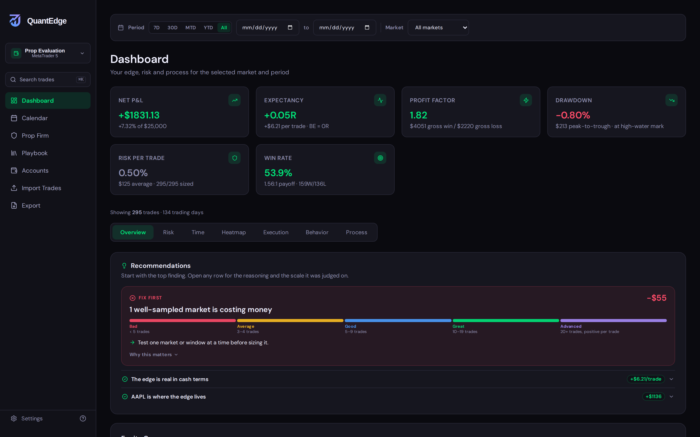
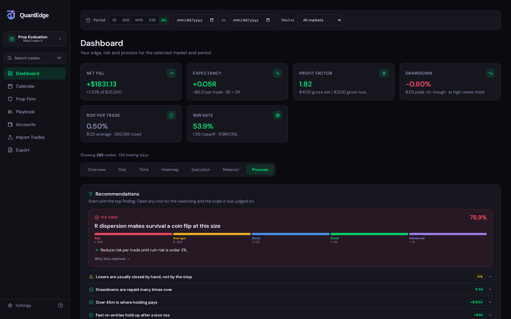
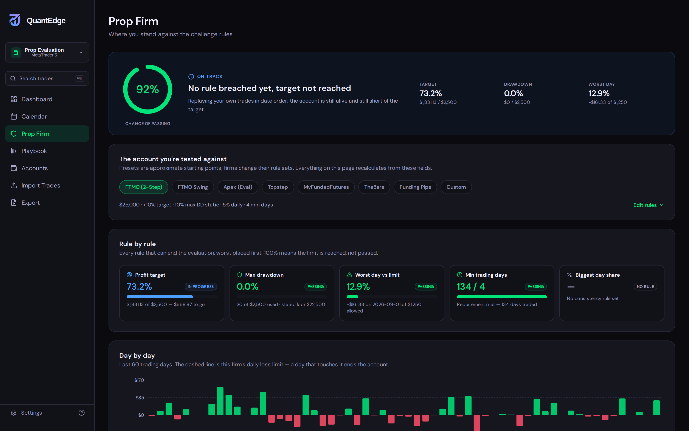
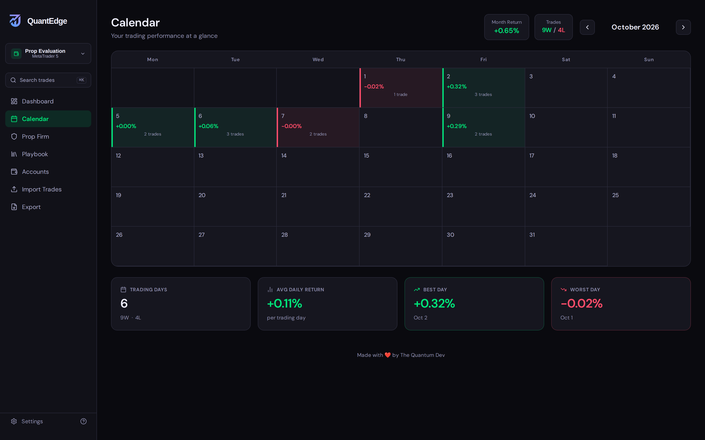
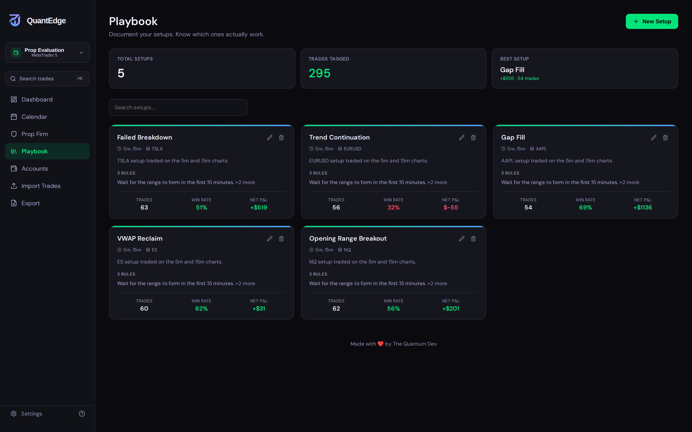
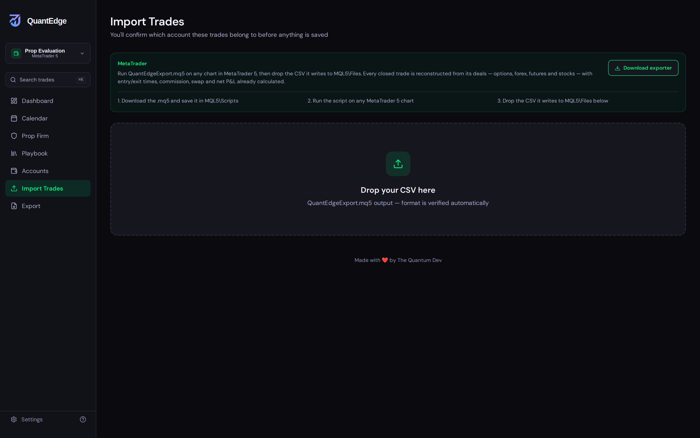
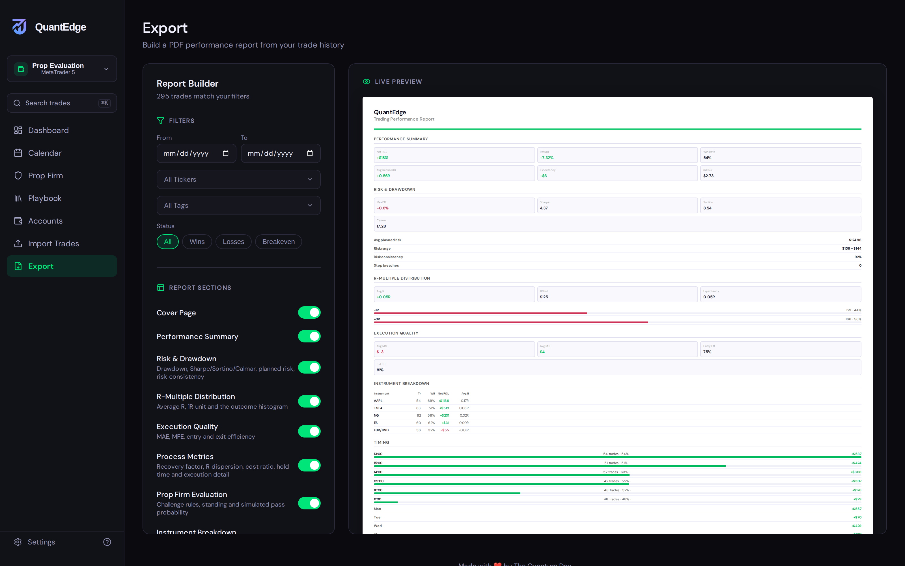
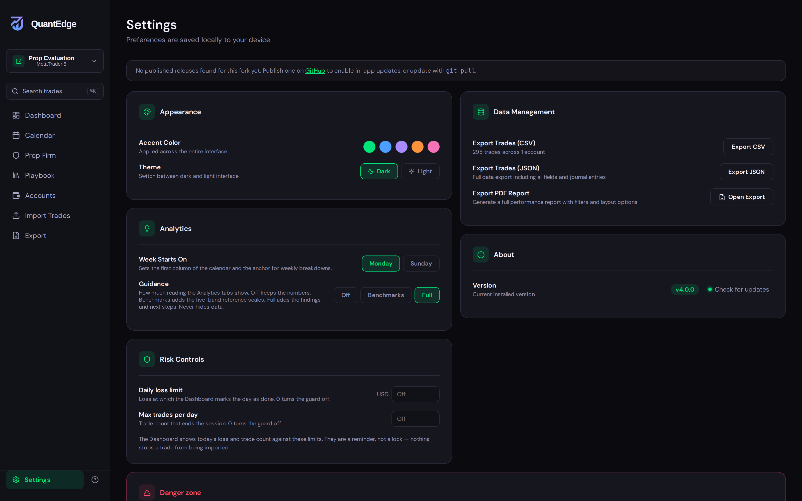

# QuantEdge

> **Fork notice.** QuantEdge began as [Journedge](https://github.com/TheQuantum-Dev/journedge)
> v4.0.0 by Quantum Dev (MIT) and is now developed independently. No affiliation with or
> endorsement by the original author; Journedge and its logo remain theirs — see [`LICENSE`](./LICENSE).

<div align="center">

<picture>
  <source media="(prefers-color-scheme: dark)" srcset="public/quantedge-logo-dark.svg">
  <source media="(prefers-color-scheme: light)" srcset="public/quantedge-logo-light.svg">
  
</picture>

<br /><br />


### A local-first trading journal for MetaTrader 5.

[Features](#features) · [Screenshots](#screenshots) · [Getting started](#getting-started) · [Import](#import-from-metatrader-5) · [Architecture](#architecture)

</div>

---

## What it is

Trades come in from a bundled MetaTrader 5 exporter and stay in a SQLite file on your
machine — no cloud, no accounts, no telemetry. On top of that data QuantEdge gives you one
place to answer three questions: where the edge actually is, what your execution cost you,
and whether your book would pass the prop challenge you are trading.

## Screenshots

| | |
|:---:|:---:|
| **Dashboard** — period-scoped metrics, analytics tabs, recommendations ranked worst-first | **Analytics · Process** — planned versus realised risk, stop adherence, holding-time edge |
|  |  |
| **Prop Firm** — rules, standing, and a bootstrap simulation of your own trades | **Calendar** — monthly P&L, day drawer, journal status per trade |
|  |  |
| **Playbook** — setups with live win rate and P&L from linked trades | **Import** — MetaTrader 5 CSV, validated column by column |
|  |  |
| **Export** — section toggles and a live, client-rendered PDF preview | **Settings** — appearance, guidance, risk controls, updates |
|  |  |

Every image is this build running on the bundled example dataset (295 synthetic trades over
nine months), captured at 1600×1000 @2x. `docs/screenshots/` also holds one capture per
analytics tab (Overview, Risk, Time, Heatmap, Execution, Behavior). Regenerate the whole set
with `node scripts/capture-screenshots.js` while the dev server is running.

## Features

**Trades and accounts**
- MetaTrader 5 import only; the header is validated column by column, so a file that is not an MT5 export says what its first line actually was
- Re-importing is safe — each row is keyed on its MT5 ticket (content hash for older exports) and upserted, so importing the same file updates instead of duplicating
- Multiple accounts, each with its own starting balance; the card shows live equity and P&L as soon as trades land
- Per trade: entry/exit times, planned risk, R:R, MAE/MFE, exit reason, tags, chart links, screenshots, notes

**Analytics**
- Seven tabs on the Dashboard — Overview, Risk, Time, Heatmap, Execution, Behavior, Process — all scoped by the global period and market filters, plus **Compare** for two cohorts side by side
- Sharpe, Sortino, Calmar, drawdown from the account's opening equity, rolling win rate, hour-of-day heatmap, MAE/MFE efficiency, re-entry and revenge-trade detection, risk of ruin with Kelly and half-Kelly
- **Recommendations** on every tab: ranked worst-first, each naming the figure it fired on, panel capped at 6 (8 on Process) with the hidden count stated; under 30 trades every section carries a provisional caveat
- Every ratio, drawdown and R-multiple is computed once in `app/lib/analytics.ts`, shared by the page and the PDF report
- Expectancy and win rate carry **95% intervals** (bootstrap / Wilson). A comparison only names a winner when the intervals separate; otherwise it says how many trades would settle it

**Research loop**
- Review any trade with **followed the plan**, a fixed mistake vocabulary and confidence at entry — then Compare splits the book by it, and the Process tab prices each break in R
- Playbook setups carry **versions**: log what changed, and trades taken after the change carry the new version, so before/after is a query
- **Experiments** store a hypothesis, a change and a start date; before/after expectancy is recomputed from the trades either side, with forward-test trades as their own cohort
- **Weekly review** page (`R`): every week's expectancy against the trader's own baseline, plan adherence, forward-test performance and running experiments
- Exports now record market context — **ATR(14)**, spread and session range at entry — so stops can be judged in ATR and exit quality in MFE capture

**Journal and playbook**
- TipTap editor per trade (headings, colours, lists, links, inline images) with debounced autosave, reusable templates, and previous/next trade navigation
- The calendar marks days whose trades have no notes yet; opening a trade never writes an empty document
- Playbook keeps setup rules and entry triggers, and shows live win rate and P&L for trades linked to each setup

**Prop firm**
- Presets or manual rules — target, daily and total drawdown (static or trailing), minimum days, time limit, consistency rule, fee, split
- Standing per rule, a pass-rate estimate from 5,000 resampled paths walked through those rules, time-and-pace, risk budget, and return on the fee

**Reporting and app**
- Client-side PDF report builder: date range, tickers, tags, status, and per-section toggles, seeded from the period you were just looking at
- CSV/JSON export, five accent colours, light/dark with no flash, and an in-app updater that backs up the database before migrating
- Global trade search on `⌘K` / `Ctrl+K` over symbol, date, tag, setup and journal text

## Getting started

Requires Node 20+ and npm.

```bash
git clone https://github.com/adam13331/QuantEdge.git
cd QuantEdge
npm install
cp .env.example .env
npx prisma migrate dev
npm run dev
```

Open http://localhost:3000. To see the app populated first, `node scripts/seed-example.js`
loads 295 deterministic synthetic trades — it **clears existing trades**, and Settings →
Clear all trades returns to an empty journal.

Then: create an account with its starting balance, compile `scripts/QuantEdgeExport.mq5`
and import the CSV it writes, and document your setups in Playbook.

## Import from MetaTrader 5

1. Compile `scripts/QuantEdgeExport.mq5` in MetaEditor (F7), then attach it from
   **Navigator → Scripts** to any chart.
2. It writes `MQL5\Files\quantedge-<login>-<date>.csv` and alerts the trade count
   (**File → Open Data Folder** finds it; the log is in **Experts**).
3. Drop that file on **Import Trades**.

The exporter groups deals by position and rebuilds each closed trade: volume-weighted
entry/exit, net P&L including commission and swap, instrument type, and times. If the
position had a stop loss it also records planned risk (which powers true R-multiples) and
scans M1 bars for MAE/MFE (set `InpExcursions = false` to skip that scan). It also stamps
ATR at entry, the symbol's spread and the session range — the context the stop and exit
analyses need. Columns are appended, so exports from older builds still import.

## Architecture

- **One route.** `app/page.tsx` maps a `PageId` union to a component; no router, no URL state.
- **Data flow.** MT5 CSV → `app/lib/parseMetaTraderCSV.ts` → `POST /api/trades` → Prisma/SQLite → `AppContext` loads everything once and pages filter in memory.
- **Trading math lives in `app/lib/analytics.ts`.** Pages render, they do not analyse.
- **Recommendations live in `app/lib/insights.ts`** and are pure: facts in, ranked findings out. All thresholds sit in one `T` block, and every `Insight` carries the `metric` it fired on.
- **`QUANTEDGE_HEADER` must match `QUANTEDGE_COLUMNS`** in the parser — changing one alone shifts every imported row without an error.
- **Recommendations stay pure.** New rules read thresholds from `T` and carry the figure they fired on; the plan-adherence, mistake and setup-version rules are in `processInsights`.
- **The database is local.** `DATABASE_URL=file:./prisma/quantedge.db` resolves against `prisma/`, so the file is `prisma/prisma/quantedge.db`; both paths are gitignored, and the updater backs it up before migrating.

Stack: Next.js 16 (App Router, Turbopack) · React 19 · TypeScript 5 · Prisma 5 + SQLite ·
Recharts 3 · TipTap 3 · @react-pdf/renderer 4 · inline styles against CSS custom properties.

## Keyboard shortcuts

| Key | Action |
|-----|--------|
| `D` `C` `F` `B` `I` `E` `R` | Dashboard · Calendar · Prop Firm · Playbook · Import · Export · Review |
| `⌘K` / `Ctrl+K` | Search trades |
| `/` | Show all shortcuts |
| `Esc` | Close the open panel |

Single-letter shortcuts are ignored while typing or while a panel is open.

## Contributing

Read [`CONTRIBUTING.md`](./CONTRIBUTING.md) before opening a pull request. Release history is
in [`CHANGELOG.md`](./CHANGELOG.md); vulnerability reports follow [`SECURITY.md`](./SECURITY.md).

## License

[MIT](./LICENSE), with the upstream attribution described in the fork notice above.
